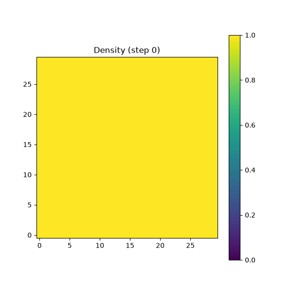

# D2Q9 Lattice Boltzmann Demo

A simple Python simulation of a density pulse on a 30 × 30 lattice with periodic boundaries.

## Run

Install the dependencies with `python -m pip install numpy matplotlib pillow`. Run the Python script from this directory to regenerate `diffusion.gif`.
